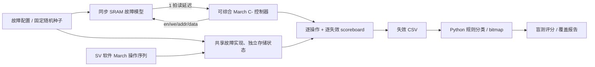

# Memory MBIST + 故障注入 + 失效数据分析

[GitHub 仓库](https://github.com/A1denHuang/memory-mbist-fault-analysis) · [CI 运行记录](https://github.com/A1denHuang/memory-mbist-fault-analysis/actions/workflows/ci.yml)

完整的存储器测试闭环：可综合 March C- RTL → 同步 SRAM 故障模型 → 独立软件操作序列和失效 scoreboard → CSV → bitmap → 盲测分类。主线使用 **256 × 1 bit** SRAM，按 **16 × 16** 映射；扩展实现了保持等待测试。

## 先看成品

- [中文验收报告](docs/验收报告.md)：已完成内容、实测数字、结果边界。
- [实测报告](results/report.md)：回归结果、分类准确率、全部误分类样本及原因。
- [原生 Questa 报告](results_questa/report.md)：SVA 和 covergroup 的汇总结果。
- [RTL](rtl/mbist_controller.sv)、[验证环境](tb/tb_mbist.sv)、[故障模型](tb/sram_fault_model.sv)、[分析入口](scripts/analyze.py)。
- 无故障：**2560 次操作、0 失效**；**60 个随机种子 × 两种模式**；**55 个盲测样本**。具体结果以随附报告和日志为准。


仓库只保留源码、汇总报告、图表和少量机器可读指标。逐例配置、CSV、观测数据和日志由脚本生成，受 `.gitignore` 排除，不需要逐个浏览。

完整证据可在 [CI 运行记录](https://github.com/A1denHuang/memory-mbist-fault-analysis/actions/workflows/ci.yml) 中选择一次成功运行，下载 **mbist-verification** 产物，保留14天。过期后可重新运行；Questa 原始日志和 UCDB 通过本地有许可的回归生成。

## 一键运行

Windows PowerShell，在项目根目录执行：

```powershell
powershell -ExecutionPolicy Bypass -File .\run.ps1
powershell -ExecutionPolicy Bypass -File .\run.ps1 -Simulator questa
```

需要 Python 3.10+，以及 PATH 中的 Icarus `iverilog/vvp` 或有有效许可的 Questa `vlib/vlog/vsim/vcover`。脚本优先使用项目 `.venv`，其次使用 PATH 中的 Python；也可通过 `-PythonExecutable` 指定解释器。分析库放在 `.deps`，缺失时从 requirements.txt 安装。不依赖特定编辑器或固定安装目录，不需要 UVM。

通用 Linux / 已配置 Python：

以下分析和审计命令使用前面回归生成的结果，不能仅凭仓库中的汇总文件执行。

```bash
python -m pip install -r requirements.txt
python scripts/run.py
python scripts/run.py --simulator questa --out results_questa
python scripts/analyze.py classify results/cases/AF_diag/fails.csv --plot af.png
python scripts/analyze.py blind --inputs results/blind_inputs --out predictions.json
python scripts/questa_random.py --seed 17 --count 3
python scripts/questa_random.py --seed 17 --batch 60 --out results_questa/native_configs/sample --verify-rtl
python scripts/mutation_check.py
python scripts/audit.py --results results --compare results_questa
python scripts/probe.py review --results results
python scripts/probe.py benchmark --out results_followup
python -m unittest discover -s tests -v
```

`run.py --no-analysis` 只验证硬件，不依赖 pandas/matplotlib。`--seeds`、`--blind-seeds` 均至少 50。固定种子可重现。输出文件会更新，已有额外文件不会自动删除，建议不同实验使用不同 `--out`。

长回归中断后，可以使用相同命令加 `--resume` 复用配置一致的已完成用例；修改RTL或验证环境后应重新完整运行，不要复用旧结果。

## 架构



参考序列按操作序号独立计算 March 元素、地址、读写和数据，不读取 DUT 内部 FSM。DUT 访问的存储器与 `reference_memory` 都实例化 **同一个 `sram_fault_model` 实现**，各自持有不同的存储状态；不是两份独立实现的故障模型。scoreboard 先检查每个操作，再比较 `(addr, element, op, expected, actual)`，因此主要验证控制器的操作序列、读比较对齐和失效上报。

故障语义由另行手写预期的 **51 项模型单元检查**支撑。共享实现中的错误可能同时影响 DUT 路径与参考路径，不能把 scoreboard 通过当成故障语义已被独立证明。面试时应主动说明“序列和状态独立、故障实现共用”的边界。

## RTL 接口与时序

| 接口 | 约定 |
|---|---|
| `rst_n` | 低有效异步复位；每次运行前复位 |
| `start` | IDLE 采样；运行中及 DONE 中忽略 |
| `stop_on_fail` | start 时锁存：0 全诊断，1 首次失效停止 |
| `en,we,addr,wdata` | 上升沿接受操作；只有 en=1 时 we/data 有意义 |
| `rdata` | 同步 SRAM 接受读后输出，控制器下一上升沿比较 |
| `compare_valid` | 当前拍正在比较上一拍的读 |
| `fail_valid` | 比较后的一个周期有效，所有失效字段同时有效 |
| `fail_op` | 0 = r0，1 = r1；`fail_element` = 0..5 |
| `done,pass` | done 保持到复位；pass 初始为1，任意失效后保持0 |
| `operation_count` | 实际接受的 SRAM 操作数，不包括比较/等待拍 |

M0 `(w0)`；M1 ↑`(r0,w1)`；M2 ↑`(r1,w0)`；M3 ↓`(r0,w1)`；M4 ↓`(r1,w0)`；M5 ↑`(r0)`。每次读插入一个比较周期，避免 stop 模式中出现失效后的额外写。无等待的完整测试有 2560 个存储器操作、1280 个比较周期；从首次操作到最后比较为3840拍，启动和结束观察另计。

`RETENTION_CYCLES=12000` 时在 M0 后等待，再执行 M1；0 表示标准 March C-。RTL 的 `ADDR_WIDTH` 可调整地址数，验证环境和物理映射固定为8位；本项目未声称实现8位字宽扩展或 HBM 电气模型。

## 故障模型与配置

配置文本第一行为数量0..3，每条记录为十进制：

```text
1
6 58 12 0 1 10000
```

字段依次是 `kind victim aggressor value trigger retention_cycles`。这里表示12地址发生上升跳变时强制58地址为0。`fault_cfg` 使用 `kind` 字段，因为 `type` 为 SV 保留字。

| kind | 类型 | 语义 |
|---:|---|---|
| 1 / 2 | SAF0 / SAF1 | 读时返回固定0 / 1 |
| 3 / 4 | TF_UP / TF_DOWN | 阻止0→1 / 1→0写跳变 |
| 5 | CFIN | 攻击单元任何有效跳变都反转受害单元 |
| 6 | CFID | 攻击单元跳变到 trigger 时将受害单元强制为 value |
| 7 | CFST | 攻击单元状态等于 trigger 时持续强制受害单元为 value |
| 8 | AF | victim 逻辑地址别名到 aggressor；读写都重映射 |
| 9 / 10 | ROW / COL | victim 对应整行 / 整列读出固定 value |
| 11 | DRF | 超过最近一次写的周期阈值后反转一次，下一次写重新计时 |

多故障按配置顺序确定性组合，允许相互掩蔽，所以不要求任意多故障组合都能检出。CF 操作针对重映射后的物理地址；CFst 和 DRF 在每次存储操作前检查，CFst 也在写后施加。DRF 使用全局时钟年龄，等待期间虽不访问，下一次访问仍会按累计年龄失效。副作用造成的受害翻转不重置写入计时。模型是教学用位单元抽象，AF 只实现单向别名，不涵盖所有译码失效。

Python 固定种子生成器提供 Icarus 可移植随机回归；`fault_cfg.sv` 和 `tb_random_cfg.sv` 提供 Questa 原生约束随机路径。可手工运行编译后的 TB：

```bash
vvp results/build/tb_mbist_0.vvp +CFG=tests/clean.cfg +SEED=17 +STOP=0 +LOG=fails.csv +SUMMARY=summary.txt +VCD=wave.vcd
```

`+TRACE=operations.csv` 可记录所有操作。原生 Questa 用 `scripts/questa_random.py` 生成可直接供同一 TB 读取的配置。

## 验收与可追溯性

| 验收项 | 对应证据 |
|---|---|
| 故障语义单元检查 | 验收报告中51项检查；完整日志见CI产物 |
| 验证环境能抓住错误 | `results/mutation_report.json`，5种代表性RTL错误全部检出 |
| 无故障、所有故障类型、两种模式 | `results/verification.json`；逐例日志见CI产物 |
| 耦合地址顺序、force/trigger组合 | `results/coupling_order_coverage.json` |
| 数组边界、行首行尾 | `results/functional_coverage.json` |
| 60随机种子，每种1..3个故障 | `results/verification.json`；完整manifest见CI产物 |
| 读延迟、done稳定、只在比较时失效 | `tb/mbist_sva.sv`、过程检查和原生断言汇总 |
| 故障×March元素交叉表 | `fault_element_coverage.csv`、报告 |
| 保持故障的局限及等待检出 | 实测报告和保持失效图；逐例数据见CI产物 |
| 盲测、准确率、错误原因 | `results/report.md`、`blind_metrics.json`、`blind_confusion.csv` |
| CI | `.github/workflows/ci.yml`，每次推送自动运行；状态见上方 CI 运行记录 |

原生断言包含6条，Icarus 另有可执行过程检查。仓库保留 `results_questa/native_assertion_summary.json`；Questa 本地回归另生成每例及合并 UCDB 和详细覆盖日志，这些原始输出不纳入版本控制。功能交叉表中的0不等于实现缺陷：M0只写不会报失效，标准 March 对选定长保持时间的DRF不敏感，部分故障-元素组合本来不可达。项目不将这些表包装成100%故障或代码覆盖率。

## 盲测的边界

盲测55个独立种子，默认11类各5个样本，每次仅注入一个故障。分析器仅读取失效CSV；先保存预测，再由评分器读取独立标签文件。随机多故障回归用于验证控制器，不混入单故障分类准确率。未检出的DRF也计入准确率分母。

规则以空间图案和March失效签名判断，输出一个首选和候选集合。**候选集合包含真实类型不代表唯一分类正确。** SAF0与TF_UP在w0初始化后的签名相同，某些耦合也会重合；AF虽能形成成对图案，也不保证所有真实译码故障都如此。详见报告中的全部误分类和补充实验建议。

另外报告 **仅合并 SAF0/TF_UP 后的等价类准确率**。其余类型保持独立，DRF 未检出仍计错，分母不变；这不是把耦合误判也归为正确的完整等价划分。

| 观测方式 | 严格类型准确率 | 仅合并SAF0/TF_UP |
|---|---:|---:|
| 原始March C-，55例 | 38/55，69.09% | 43/55，78.18% |
| 原55例加辅助测试（开发评估） | 45/55，81.82% | 50/55，90.91% |
| 新55个种子加辅助测试 | 45/55，81.82% | 50/55，90.91% |

## 耦合故障辅助诊断

新增的 toggle/rewrite 测试从失效 CSV 选择受害地址，遍历其余255个候选攻击地址，同时覆盖两种初始攻击状态和两种受害背景。每个试验读取“写入稳定后、攻击翻转后、受害重写后”的响应。分类器只接收观测 CSV；注入配置仅供仿真存储器装载，不参与推断。

| 类型 | 可观察的因果响应 |
|---|---|
| CFIN | 两种攻击跳变都反转受害值，受害重写可以恢复 |
| CFID | 特定攻击跳变将受害强制为某值，受害重写可以恢复 |
| CFST | 特定攻击状态持续强制受害值，该状态下受害重写不能恢复相反背景 |

- [已审阅55例的辅助诊断](results/followup/report.md)：作为开发集评估，和原始 March-only 基线分开保留。
- [新种子评估](results_followup/report.md)：使用200001开始的新种子，固定方法后再评分；严格类型与等价类指标分列。

两组中CFST均由0/5提升为5/5，CFIN均由3/5提升为5/5。剩余严格误分类是TF_UP与SAF0不可分，以及未敏化的DRF；没有将它们隐藏或从分母排除。

每个受害单元增加3060次读和4080次写。每个试验重置行为模型状态是仿真测试条件，不是芯片端可直接使用的操作；实际器件需要另行论证复位或预置方法。辅助结果不代表标准 March C- 的覆盖率提高，也不独立证明故障语义。

## 文件目录

```text
rtl/       可综合控制器
tb/        故障模型、软件参考、scoreboard、SVA、covergroup、随机配置类
scripts/   回归、分类、图形、盲测评分、Questa约束随机验证
tests/     可直接使用的无故障配置
docs/      设计说明与面试问答
results/   Icarus汇总报告、图表、覆盖及分类指标
results_questa/  Questa汇总报告、图表及原生断言摘要
results_followup/  新种子辅助诊断汇总报告与指标
.github/   可移植CI工作流
```

公开仓库保留源码、图表和汇总证据；逐例输出、`.deps`、编译缓存、波形、UCDB 和本机许可证文件不纳入版本控制。发布检查会阻止逐例输出意外入库。本地完整结果保留，原始证据也可通过CI或本地回归重新生成。项目未附加开源许可证。
