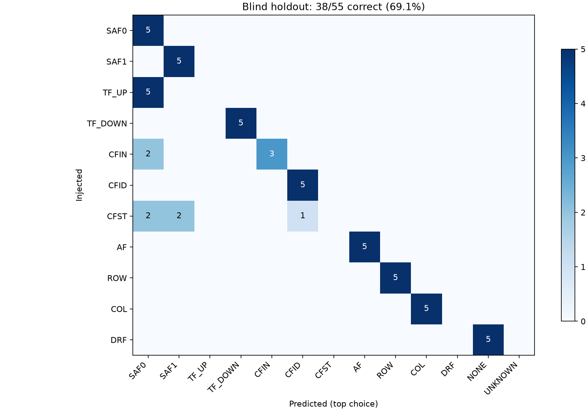
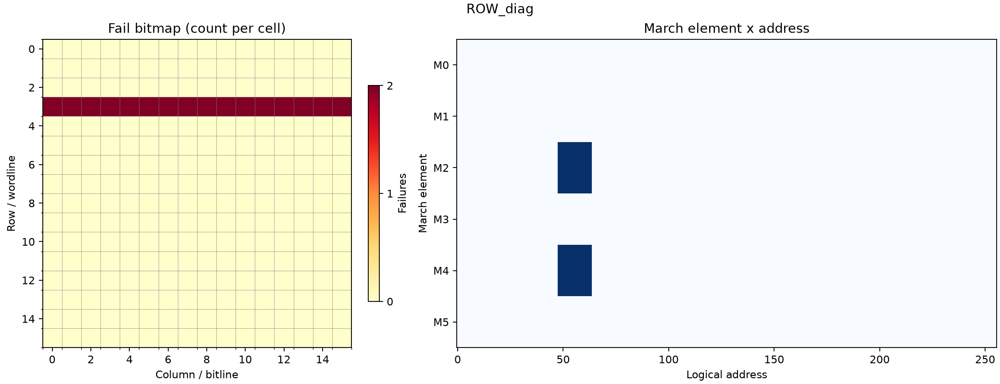
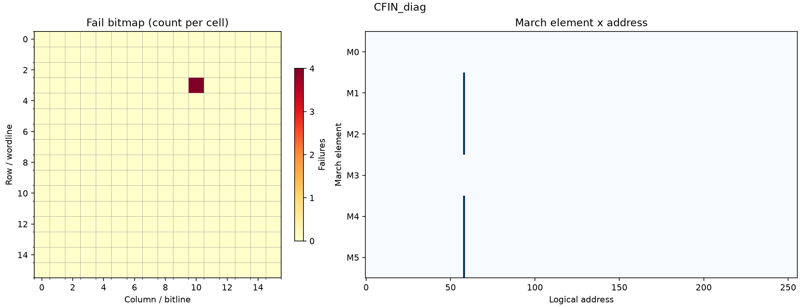

# Verification and blind analysis report

Simulator: iverilog. All 283 RTL simulations passed the operation and failure-tuple scoreboard.
Random regression: 60 independent seeds, each with 1-3 faults, both modes.
Healthy memory: 2560 accepted operations, zero failures, pass=1 in both modes.
Model-only unit tests: 51 checks passed. The full fault_model_units.log is a local/CI artifact, not a tracked repository file.
Verification boundary: reference sequence/state are separate, but both memory instances use sram_fault_model. The scoreboard verifies controller behavior; fault semantics are checked by the 51 model-only tests, not independently proven by the scoreboard.
Assertion status: portable procedural equivalents passed; native SVA not executed.
Functional bins: 12/12 element x mode; 32/32 row/array boundary addresses.

## Blind holdout

Top-choice exact type accuracy: **38/55 = 69.09%**.
SAF0/TF_UP equivalence-class accuracy: **43/55 = 78.18%**.
Only SAF0 and TF_UP are merged into SAF0_OR_TF_UP; every other label remains distinct. All samples remain in the denominator. This is a limited equivalence adjustment, not a claim that all other March signatures are uniquely identifiable.
Candidate-set inclusion: **55/55 = 100.00%** (not exact-type accuracy).
Balanced, independent single-fault holdout; 5 samples/type by default. Classifier input contains fail CSVs only. Mixed-fault regression is a controller correctness test, not a classification benchmark.
DRF no-failure observations remain in the denominator. No-fail does not prove no fault.
Rules were fixed before inspecting holdout labels; no model training or truth-driven label lookup. Results are for this behavioral model, not silicon performance.

## Every misclassified case

| Seed | Injected | Predicted | Reason |
|---|---|---|---|
| 100003 | TF_UP | SAF0 | Read-1 failures at both backgrounds. SAF0 and TF_UP are observationally identical after w0 initialization; coupling can alias them. |
| 100005 | CFIN | SAF0 | Read-1 failures at both backgrounds. SAF0 and TF_UP are observationally identical after w0 initialization; coupling can alias them. |
| 100007 | CFST | SAF0 | Read-1 failures at both backgrounds. SAF0 and TF_UP are observationally identical after w0 initialization; coupling can alias them. |
| 100011 | DRF | NONE | No observed failures: healthy memory or unsensitized/masked fault, including long-threshold DRF. |
| 100014 | TF_UP | SAF0 | Read-1 failures at both backgrounds. SAF0 and TF_UP are observationally identical after w0 initialization; coupling can alias them. |
| 100018 | CFST | SAF1 | All read-0 elements fail, including the first read after initialization. |
| 100022 | DRF | NONE | No observed failures: healthy memory or unsensitized/masked fault, including long-threshold DRF. |
| 100025 | TF_UP | SAF0 | Read-1 failures at both backgrounds. SAF0 and TF_UP are observationally identical after w0 initialization; coupling can alias them. |
| 100027 | CFIN | SAF0 | Read-1 failures at both backgrounds. SAF0 and TF_UP are observationally identical after w0 initialization; coupling can alias them. |
| 100029 | CFST | SAF1 | All read-0 elements fail, including the first read after initialization. |
| 100033 | DRF | NONE | No observed failures: healthy memory or unsensitized/masked fault, including long-threshold DRF. |
| 100036 | TF_UP | SAF0 | Read-1 failures at both backgrounds. SAF0 and TF_UP are observationally identical after w0 initialization; coupling can alias them. |
| 100040 | CFST | CFID | Partial-element single-cell signature suggests coupling; fail CSV alone cannot resolve subtype or aggressor. |
| 100044 | DRF | NONE | No observed failures: healthy memory or unsensitized/masked fault, including long-threshold DRF. |
| 100047 | TF_UP | SAF0 | Read-1 failures at both backgrounds. SAF0 and TF_UP are observationally identical after w0 initialization; coupling can alias them. |
| 100051 | CFST | SAF0 | Read-1 failures at both backgrounds. SAF0 and TF_UP are observationally identical after w0 initialization; coupling can alias them. |
| 100055 | DRF | NONE | No observed failures: healthy memory or unsensitized/masked fault, including long-threshold DRF. |

## Single-fault detection cross table

Counts are observed fail events, not theoretical coverage percentages. Zero M0 is expected because it only writes. DRF baseline zeros are intentional; see retention_pause.

| Fault | M0 | M1 | M2 | M3 | M4 | M5 |
|---|---:|---:|---:|---:|---:|---:|
| SAF0 | 0 | 0 | 6 | 0 | 6 | 0 |
| SAF1 | 0 | 6 | 0 | 6 | 0 | 6 |
| TF_UP | 0 | 0 | 6 | 0 | 6 | 0 |
| TF_DOWN | 0 | 0 | 0 | 6 | 0 | 6 |
| CFIN | 0 | 9 | 17 | 0 | 17 | 9 |
| CFID | 0 | 2 | 4 | 4 | 5 | 2 |
| CFST | 0 | 6 | 9 | 6 | 9 | 6 |
| AF | 0 | 6 | 6 | 6 | 6 | 0 |
| ROW | 0 | 80 | 16 | 80 | 16 | 80 |
| COL | 0 | 80 | 16 | 80 | 16 | 80 |
| DRF | 0 | 0 | 0 | 0 | 0 | 0 |

## Coupling ordering observed in simulation

| Injection / ordering | Detected elements |
|---|---|
| CFID aggressor < victim; force=0, trigger=0 | M2 |
| CFID aggressor < victim; force=0, trigger=1 | M4 |
| CFID aggressor < victim; force=1, trigger=0 | M5 |
| CFID aggressor < victim; force=1, trigger=1 | M1 |
| CFID aggressor > victim; force=0, trigger=0 | M4 |
| CFID aggressor > victim; force=0, trigger=1 | M2 |
| CFID aggressor > victim; force=1, trigger=0 | M3 |
| CFID aggressor > victim; force=1, trigger=1 | M3 |
| CFIN aggressor < victim; force=0, trigger=0 | M1, M2, M4, M5 |
| CFIN aggressor < victim; force=0, trigger=1 | M1, M2, M4, M5 |
| CFIN aggressor < victim; force=1, trigger=0 | M1, M2, M4, M5 |
| CFIN aggressor < victim; force=1, trigger=1 | M1, M2, M4, M5 |
| CFIN aggressor > victim; force=0, trigger=0 | M2, M4 |
| CFIN aggressor > victim; force=0, trigger=1 | M2, M4 |
| CFIN aggressor > victim; force=1, trigger=0 | M2, M4 |
| CFIN aggressor > victim; force=1, trigger=1 | M2, M4 |
| CFST aggressor < victim; force=0, trigger=0 | M2, M4 |
| CFST aggressor < victim; force=0, trigger=1 | M2, M4 |
| CFST aggressor < victim; force=1, trigger=0 | M1, M3, M5 |
| CFST aggressor < victim; force=1, trigger=1 | M1, M5 |
| CFST aggressor > victim; force=0, trigger=0 | M2, M4 |
| CFST aggressor > victim; force=0, trigger=1 | M2, M4 |
| CFST aggressor > victim; force=1, trigger=0 | M1, M3, M5 |
| CFST aggressor > victim; force=1, trigger=1 | M3 |

## Interpretation and follow-up

- SAF0 and TF_UP share M2/M4 under a w0-first March C- sequence; failure CSV alone cannot distinguish them.
- CFin after-victim can share that same signature. CFid and CFst can mimic stuck-at or transition faults depending on trigger/forced value.
- AF remaps one victim to one aggressor; not all real decoder open/multiple-select faults are modeled.
- For ambiguous cases, run a targeted aggressor-toggle test, independent address-isolation test, changed initialization, or pause-time sweep.
- DRF threshold=10000 cycles is longer than base test duration; a 12000-cycle pause after M0 sensitizes it.
- Additional observations are evaluated separately: [reviewed development samples](../results/followup/report.md) and [fresh-seed evaluation](../results_followup/report.md). Their improvement is not attributed to March C- alone.
- Portable runs check behavior procedurally. Native SVA and covergroup summaries are supplied separately in ../results_questa/; these are not code coverage or synthesis results.

## Full evidence and reproduction

This repository tracks summaries and figures only. Per-case configs, CSVs, labels, predictions and logs are generated by scripts/run.py and ignored by Git. Download the mbist-verification artifact from a [CI run](https://github.com/A1denHuang/memory-mbist-fault-analysis/actions/workflows/ci.yml) (14-day retention), or rerun locally. Native Questa details require a local licensed Questa run.

## Example bitmaps

